<div align="center">

# 🤖 Saathi
### *Raasta bhi, saath bhi.* The way, and the company.

**A guide robot for Indian hospital OPDs. It talks in Hindi, reads the crowd like a person, explains every move, and shares one memory with other Saathis so a lost child is found where he is *now*.**

[](https://unstop.com/hackathons/hack-in-hills-26-galgotias-university-gu-greater-noida-1752595)
[](#-ps-01-every-line-with-proof)
[](#-run-it)
[](#-how-it-works)
[](#-run-it)

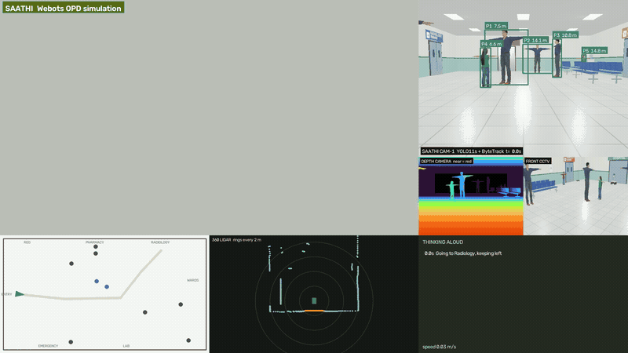

*One real run. Chase cam · Saathi's camera with YOLO boxes and distances · depth · floor map · 360° LiDAR · its thinking log.*

<br>

**30-second version**

🏥 Indian OPDs lose patients, not just time: 7 in 10 first-timers need a human to find the way.<br>
🤖 Saathi walks them there, Hindi mein, without pushing through crowds, and can answer *"tum ruke kyun?"* with the camera frame as proof.<br>
👨‍👩‍👦 Several Saathis share one memory of people, so *"mera beta kho gaya"* is answered in seconds, with no face ever stored.<br>
📊 Every claim below comes from a seeded, re-runnable benchmark. 200 crowds. 200 lost children. Same numbers every time.

</div>

<br>

---

## 🏥 The problem, in four numbers

<table align="center">
<tr>
<td align="center" width="25%"><h1>14–15k</h1>OPD patients <b>a day</b><br>at AIIMS Delhi</td>
<td align="center" width="25%"><h1>69.6%</h1>of first-time OPD visitors<br><b>needed a person</b> to find their way</td>
<td align="center" width="25%"><h1>98%</h1>of older patients at AIIMS<br>geriatric OPD <b>come alone</b></td>
<td align="center" width="25%"><h1>0</h1>wayfinding robots found<br>in any Indian OPD, 2024–26</td>
</tr>
</table>

<p align="center">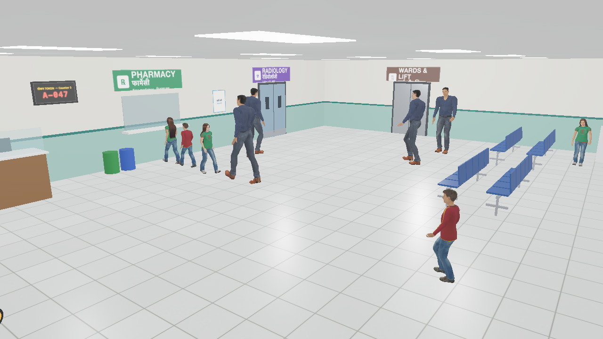</p>
<p align="center"><sub>Our OPD hall in Webots: Hindi + English signs, token display, pharmacy queue, waiting chairs, animated people on their own errands. Saathi at the registration counter, bottom left.</sub></p>

<sub>Sources: AIIMS OPD load, UNI and Free Press Journal, Sep 2026 · GMC Bhopal, IJCMPH 2026 (336 first-time visitors) · AIIMS geriatric OPD, Research Square preprint, Aug 2026 · RIMS Ranchi, Cureus, Sep 2026: 58% of 400 patients waited over 3 h.</sub>

<br>

## 🚶 Ek din OPD mein: what Saathi does

<table>
<tr>
<td width="50%" align="center">
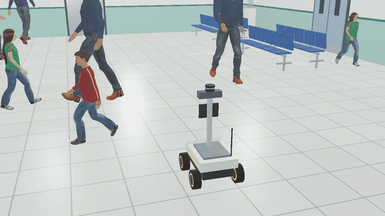
<br><b>"Mujhe X-ray karwana hai." Chalo.</b><br><sub>Walks you to Radiology at your pace. Predicts where each person will be in 2 s; slides sideways on mecanum wheels instead of stopping dead.</sub>
</td>
<td width="50%" align="center">
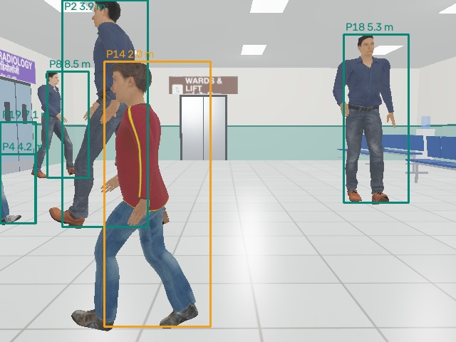
<br><b>Sees every person with an ID and a distance</b><br><sub>YOLO11 + depth camera + 360° LiDAR. People placed on the floor within 0.10 m. Orange = the one it is yielding to.</sub>
</td>
</tr>
<tr>
<td colspan="2" align="center">
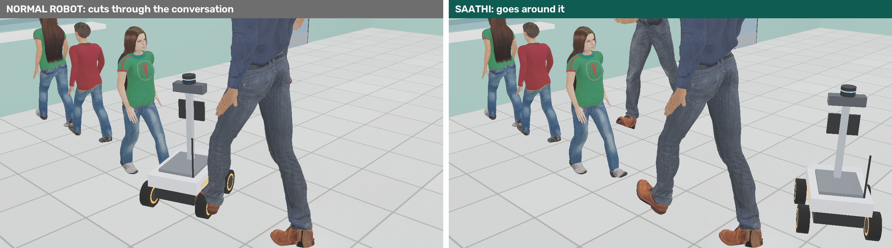
<br><b>Never cuts through a conversation. Wheelchairs go first. Keeps left.</b><br><sub>Same crowd, same goal. Left: a normal planner treats people as obstacles. Right: Saathi reads the group and goes around.</sub>
</td>
</tr>
<tr>
<td align="center">

<br><b>Sees what the map does not have</b><br><sub>A wet-floor board and a cardboard box nobody told it about. Map-only robot hit 2. Saathi: 0.</sub>
</td>
<td align="center">
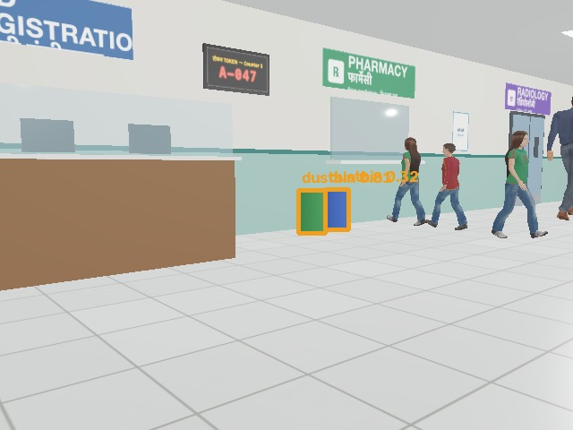
<br><b>"Dustbin dhoondo."</b><br><sub>Turns, asks open-vocabulary vision for "dustbin", sees it 7.5 m away, drives there in 12 s. Works for any word: wheelchair, water cooler, sign board.</sub>
</td>
</tr>
<tr>
<td align="center">
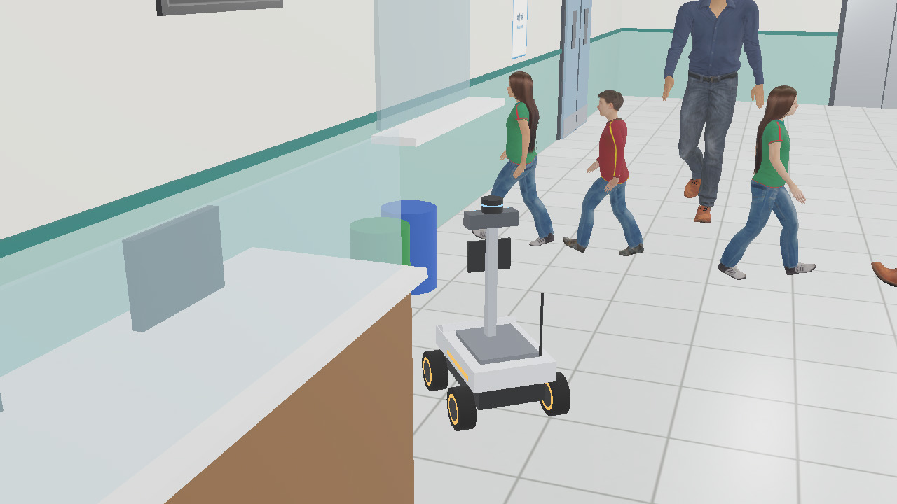
<br><b>Arrives. Says so, in Hindi.</b><br><sub>Hindi, Hinglish or English, fully offline. Asks when unsure: "Kaunsa red shirt?"</sub>
</td>
<td align="center">
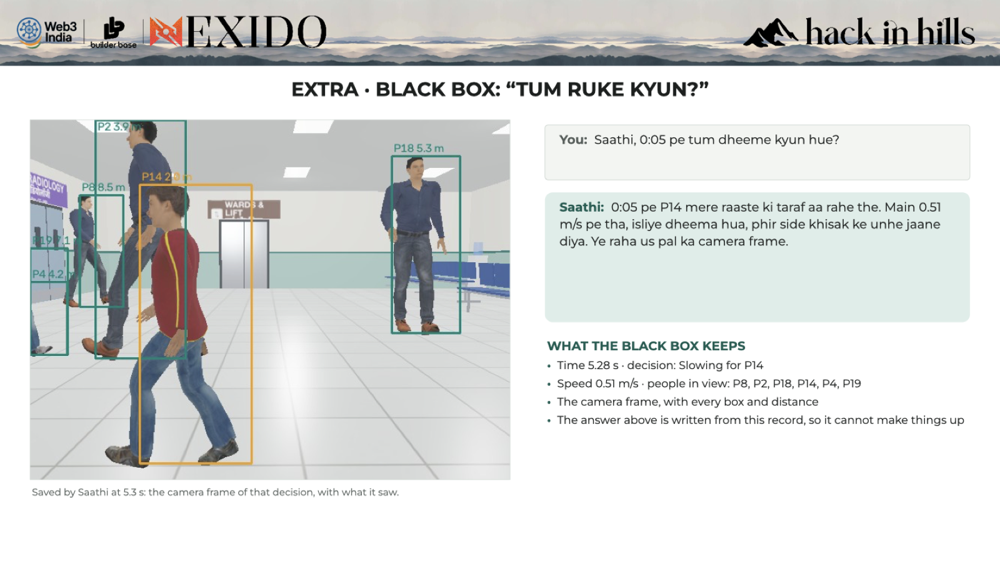
<br><b>"Tum ruke kyun?"</b><br><sub>Every decision is saved with its camera frame and reason. The answer is written from the record, so it cannot make things up.</sub>
</td>
</tr>
</table>

<br>

## 🚨 Gira, ya aaram kar raha hai?

<p align="center">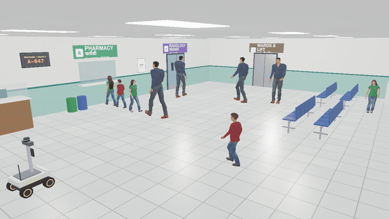</p>

<table align="center">
<tr>
<td align="center"><h2>0.3 s</h2>fall classified<br><sub>YOLOE: "person lying on the floor"</sub></td>
<td align="center"><h2>5.4 s</h2>alert at the nurse station<br><sub>"Patient fallen near the middle of the hall, 5 m from Lab"</sub></td>
<td align="center"><h2>4.9 s</h2>second opinion from a VLM<br><sub>"a man is lying on the floor, possibly injured or unwell"</sub></td>
<td align="center"><h2>stays</h2>until the nurse takes over<br><sub>then finishes its trip</sub></td>
</tr>
</table>

<p align="center"><sub>People rest on OPD floors every day. A plain "lying down" detector would page nurses all day; Saathi's memory knows who was already resting.</sub></p>

<br>

## 🏥 Poora hospital: two floors, one lift

**"Blood bank kahan hai?"** It is upstairs. Saathi drives to the lift lobby, calls the lift, rides up, and walks you there. Then back down to the Lab. Every department by voice: Registration, Pharmacy, Radiology, Lab, Emergency on the ground floor; Blood Bank, ICU, OT, Wards and the Nurse Station on the first.

<table>
<tr>
<td width="50%" align="center">
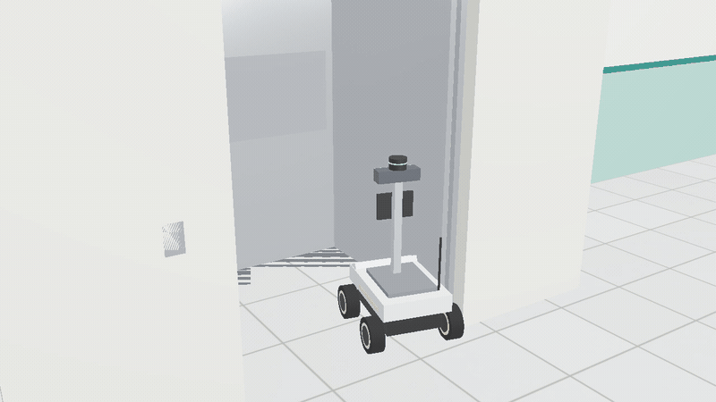
<br><b>🛗 Takes the lift on its own</b><br><sub>Doors close, cabin travels, doors open upstairs. The camera keeps seeing; the map switches floors.</sub>
</td>
<td width="50%" align="center">
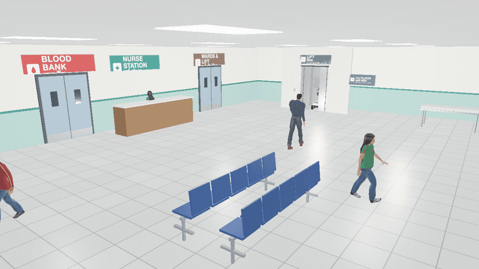
<br><b>🩸 First floor: Blood Bank, ICU, OT, Wards</b><br><sub>A nurse at her station, visitors, a stretcher, stairs down. New floor, same brain.</sub>
</td>
</tr>
</table>

<p align="center"><sub>One run, on its own camera: Pharmacy → lift → Blood Bank → lift → Lab in 135 s, with a fall handled on the way. <code>tools/demo.sh</code> plays it live in Webots.</sub></p>

<br>

## 👨‍👩‍👦 Saathi Parivaar: *ek yaad, kai aankhein*

**"Mera beta kho gaya, laal t-shirt, chhota sa hai."** Every Saathi in the hospital answers from one shared memory. One stays with papa. One goes where the boy is **now**, not where he was seen.

<p align="center">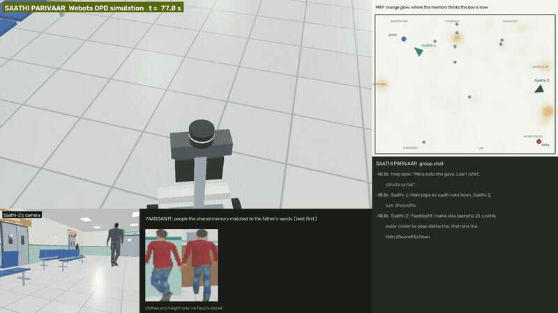</p>

<table>
<tr>
<td align="center" width="25%"><h3>1 · Remember</h3><sub>Each robot logs who it saw: where, when, how tall, which way. Clothes only, never a face.</sub></td>
<td align="center" width="25%"><h3>2 · Ask</h3><sub>Papa's words search every robot's memory. "Saathi-2 saw him 21 s ago at the water cooler."</sub></td>
<td align="center" width="25%"><h3>3 · Where now?</h3><sub>From his last motion, where can he be now? Places already checked and found empty are ruled out.</sub></td>
<td align="center" width="25%"><h3>4 · Search as a team</h3><sub>Robots split the likely places. One stays with papa. Found: his record is deleted.</sub></td>
</tr>
</table>

<p align="center"></p>
<p align="center"><sub>"Small child in a red shirt": the top 8 of 96 people seen are all him. Woman in green, man in blue: 24 of 24 right.</sub></p>

**One memory, five jobs**

| 🧒 Khoya-Paya | 👀 Bichhadne se pehle | 🎫 Vaada | 🛏️ Doosri raay | 🤝 Ek ruke, ek bulaye |
|:---:|:---:|:---:|:---:|:---:|
| finds a lost child | spots a child drifting from family *before* anyone reports it | fetches you before your token | fell, or resting on the floor? | one stays, one fetches help |

<br>

## 📊 Numbers, not promises

<table align="center">
<tr>
<td align="center" width="25%"><h1>73%</h1><b>fewer near-misses</b><br>3.79 → 1.00 per trip</td>
<td align="center" width="25%"><h1>0 / 200</h1><b>conversations cut</b><br>normal robot: 26%</td>
<td align="center" width="25%"><h1>199 / 200</h1><b>trips arrived</b><br>normal robot: 185</td>
<td align="center" width="25%"><h1>2×</h1><b>faster lost-child search</b><br>with memory, one robot</td>
</tr>
</table>

<p align="center">


</p>

<details>
<summary><b>Same crowd, three robots, in Webots</b></summary>
<br>

| | Normal robot | Saathi (true positions) | Saathi, **camera + LiDAR only** |
|---|:---:|:---:|:---:|
| Near-misses | 4 | 0 | 1 |
| Cut through the conversation | yes | no | no |
| Time to Radiology | 22 s | 25 s | 29 s |

</details>

<details>
<summary><b>Lost child, 200 seeds: found within 3 min · median time</b></summary>
<br>

| Strategy | 1 robot | 2 robots | 3 robots |
|---|:---:|:---:|:---:|
| Sweep the floor, no memory | 47% · 180 s | 83% · 70 s | 90% · 43 s |
| Go to last sighting | 61% · 106 s | 79% · 56 s | 91% · 42 s |
| **Where is he now** (Saathi) | **64% · 84 s** | 71% · 51 s | 87% · 39 s |

Honest reading: one robot with memory finds the child in half the time. With a team, team size matters more than strategy; a split-search strategy is being tested on held-out seeds for the finale.

</details>

<details>
<summary><b>Speed on an 8 GB M1 laptop</b></summary>
<br>

| Measure | Value |
|---|---|
| YOLO11n per frame | 9.5 ms |
| Planner | ~5 ms a plan, replans twice a second |
| People placed on the floor | 0.10 m median error |
| Fall classified | 0.3 s |
| VLM scene description (Qwen3.5-2B, Apple MLX) | 3–5 s |
| Hindi voice self-test | 5/5 understood, ~3 s each |
| Mecanum motion vs command | within 7% |

</details>

<p align="center"><sub>Every number is reproduced by <code>tools/bench.py</code>, <code>tools/bench_lost.py</code> and <code>tools/final_runs.sh</code>. Seeded and deterministic.</sub></p>

<br>

## 💡 What is new here

| | Exists | Saathi adds |
|---|---|---|
| 🧠 | ReMEmbR (NVIDIA 2024): a robot recalls where it *saw* things | Where a person **is now**, from a fresh sighting, and goes to intercept |
| 👤 | HUMEMBR (IROS 2026): finds known people by face and routine | **Strangers**, by clothes and height only. No face stored, ever |
| 📷 | Kumbh 2025 khoya-paya: face recognition on fixed cameras | Robots remember **where they looked and saw no one** |
| 🤖 | Lost-child robots (Japan 2017): share spoken descriptions | A team that **splits the search**; one robot always stays with the family |
| 📼 | Self-driving car black boxes | An **ethical black box** on a social robot that answers "why?" in Hindi with the frame |
| 🧪 | Social-nav benchmarks abroad | The first **Indian OPD crowd benchmark**: 200 seeded crowds, 200 lost children |

<br>

## ⚙️ How it works

<p align="center"></p>

<div align="center">


</div>

| Layer | What it does |
|---|---|
| ⚡ **Reflex brain, 30 Hz** | Camera + depth + LiDAR → people with speed → A* on a crowd costmap (personal space, conversation groups, wheelchairs first, keep-left) |
| 🧠 **Thinking brain** | Whisper hears Hindi, a phrasebook understands it, Qwen3.5-2B describes scenes and reads signs, Lekha answers. All offline |
| 🛑 **Safety guard** | Runs on LiDAR, not the AI. Stops under 0.6 m. Fist = stop, palm = go. **Nothing above it can override it** |
| 👥 **Shared memory** | Who each robot saw, where, when, how tall, which way; CLIP crop (clothes); which floor cells were seen empty; particles for "where now" |
| 📼 **Black box** | Every decision + camera frame + reason, replayable |

<br>

## ✅ PS-01: every line, with proof

<p align="center">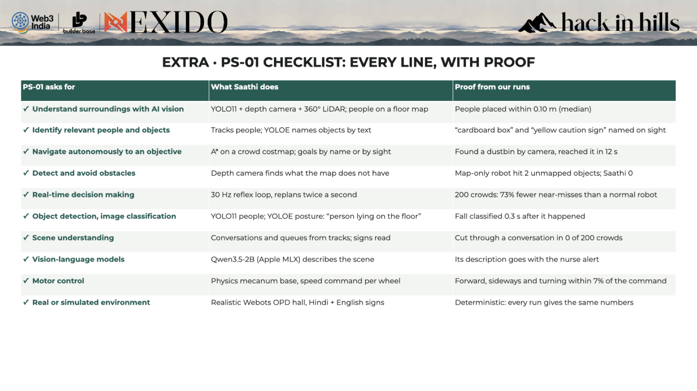</p>

<br>

## 🔒 Safe and private by design

| 🛑 | 👊 | 🙈 | 🗑️ | 📝 |
|:---:|:---:|:---:|:---:|:---:|
| 0.6 m hard stop on LiDAR, below the AI | Fist gesture stops it; red e-stop on the real rover | Clothes and height only, never a face | Record deleted after a reunion, memory wiped daily | Every search and decision logged |

<br>

## 🛞 The body

<p align="center">


</p>
<p align="center"><sub>Our rover design, and the same rover in Webots: stereo camera, depth camera, 360° LiDAR, IMU, mecanum wheels, Jetson Orin Nano. We add a face screen, mic, speaker and e-stop. The same brain drives both.</sub></p>

<br>

## 🧭 For the judges

| Criterion | Where to look |
|---|---|
| Innovation | [What is new here](#-what-is-new-here) · [Saathi Parivaar](#-saathi-parivaar-ek-yaad-kai-aankhein) |
| Functional implementation | [Whole hospital](#-poora-hospital-two-floors-one-lift): one run, two floors, a lift, a fall, on its own camera |
| Problem-solution fit | [The problem](#-the-problem-in-four-numbers) · Hindi first, built for Indian crowds and floors |
| Technical execution | [How it works](#-how-it-works) · [PS-01 proof](#-ps-01-every-line-with-proof) |
| Impact | 14–15k patients a day at one hospital; 816 medical colleges, 714 district hospitals |
| Usability | Voice in Hindi, walks at your pace, explains itself, stops for a fist |
| Presentation | This page · [Round 1 deck](ppt/Saathi_HackInHills26.pdf) · [full write-up](docs/DETAILS.md) |

<br>

## 🗺️ Roadmap

```
Oct 2026  ✅ Webots OPD · crowd planner · camera+LiDAR+depth · fall alert · VLM · black box · shared memory · Hindi voice · 2 benchmarks
24 Oct    🔨 Prototype round: one command runs it all · 2 robots · gesture stop · demo video
20–21 Nov 🏔️ Manali finale: 3 robots live and fully offline on a laptop · held-out 200-seed test
2027      🤖 Real rover (Jetson Orin Nano) · pilot in one OPD with consent and face blurring
Next      🌐 More Indian languages (Bhashini) · token/queue integration · staff app · stations, airports, melas
```

<br>

## ▶️ Run it

```sh
tools/demo.sh                                   # whole hospital, live: Pharmacy -> lift -> Blood Bank -> lift -> Lab, a box, a fall
tools/live.sh && .venv-brain/bin/python tools/voice.py   # (two terminals) talk to it in Hindi: "Blood bank kahan hai?"
.venv/bin/python tools/bench.py 200             # 200-crowd A/B, reproduces the numbers above
.venv/bin/python tools/bench_lost.py 200        # 200 lost children x 3 strategies x 1-3 robots
```

Setup, every command, methods, sources and honest limits: **[docs/DETAILS.md](docs/DETAILS.md)**

<br>

## 👥 Team Glitch

| | | |
|---|---|---|
| 🧑‍💻 **Ayush Kumar** | Lead | robot & simulation, vision & AI, shared memory, Hindi voice |
| 📚 **Soumya Raghuwanshi** | Research | Indian hospital data and sources |
| 🎤 **Simran Kumari Keshri** | Testing & pitch | voice tests, demo video |

<div align="center">
<br>
<sub>Hack in Hills '26 · PS-01 Vision-Based Autonomous Robot · Built on a MacBook Air M1, 8 GB · <a href="ppt/Saathi_HackInHills26.pdf">Round 1 deck</a></sub>
<br><br>
<b><i>Raasta bhi, saath bhi.</i></b>
</div>
