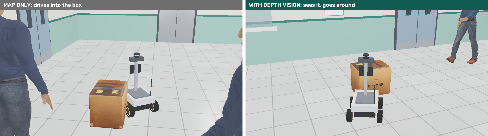
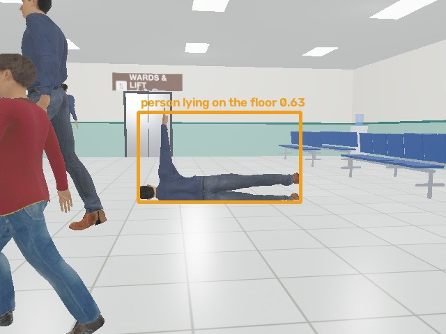
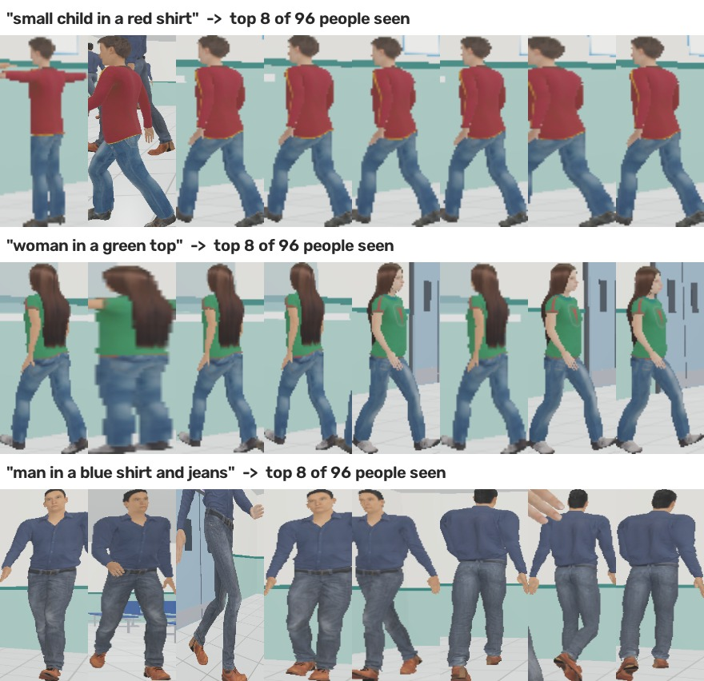
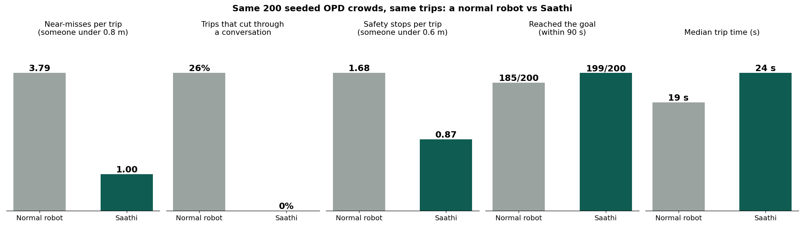
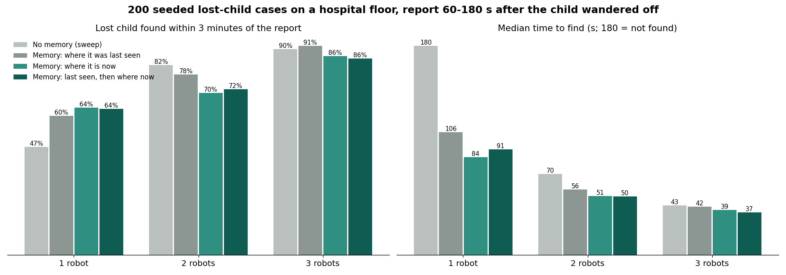
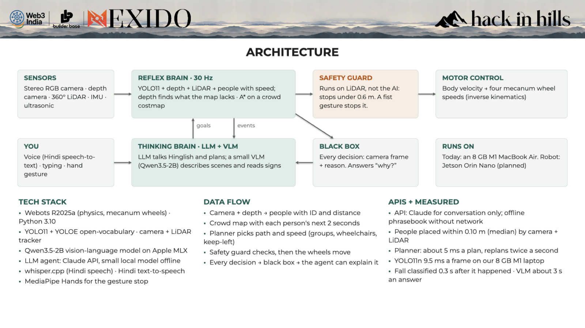
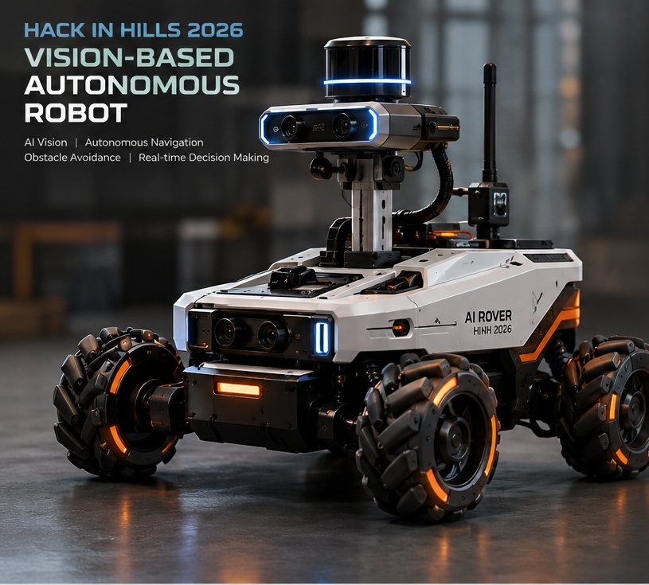
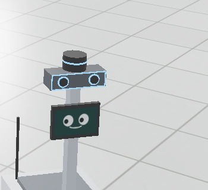

# Saathi: full write-up

Everything behind the README, with sources, methods and run commands. Back to the [README](../README.md).

## The problem

Big Indian OPDs are packed, confusing and signed in English. First-time, elderly and low-literacy patients get lost, and staff leave their work to show them the way.

<table align="center">
<tr>
<td align="center"><h2>14–15k</h2>OPD patients <b>a day</b> at AIIMS Delhi</td>
<td align="center"><h2>69.6%</h2>of first-time OPD visitors needed <b>a person</b> to find their way (GMC Bhopal)</td>
<td align="center"><h2>3 h+</h2>total OPD wait for 58% of 400 patients (RIMS Ranchi, 2026)</td>
<td align="center"><h2>98%</h2>of older patients at AIIMS geriatric OPD <b>come alone</b> (preprint, 2026)</td>
</tr>
</table>

**Impact today:** hours lost, appointments missed, help desks and nurses pulled away from care, a fall in a packed hall noticed late. And today's robot planners either freeze in dense crowds or cut straight through people.

**The gap:** our 2024–26 search found no wayfinding robot working in an Indian OPD. Guide robots already work in airports abroad (SPENCER at Schiphol); Indian OPD crowds are denser.

<sub>Sources: AIIMS OPD load, UNI and Free Press Journal, Sep 2026 · GMC Bhopal, IJCMPH 2026 (336 first-time visitors) · RIMS Ranchi, Cureus, 20 Sep 2026 · AIIMS geriatric OPD, Research Square preprint, Aug 2026</sub>

## The solution

Say **"Mujhe X-ray karwana hai"** and Saathi walks you to Radiology at your pace, reading the crowd with its camera, and it can explain every move.

| | Feature | What it means on the floor |
|---|---|---|
| 🗣️ | **Talks like a person** | Hindi, Hinglish or English, fully offline. Asks when unsure: *"Kaunsa red shirt?"* |
| 👀 | **Reads the crowd** | Predicts where each person will be in 2 s. Never cuts through a conversation; wheelchairs go first. |
| ↔️ | **Side-steps, keeps left** | Mecanum wheels slide it aside instead of stopping dead in a busy corridor. |
| 🔍 | **Finds things by name** | *"Dustbin dhoondo"*: open-vocabulary detection (YOLOE) finds it by sight, and Saathi drives there. |
| 🚨 | **Watches out** | Spots a fall, gets a second opinion from a vision-language model, alerts the nurse station and **stays with the patient**. |
| 🛑 | **Safe by design** | Hard stop under 0.6 m on LiDAR, and a fist gesture stops it. **No AI can override either.** |
| 📼 | **Black box** | Every decision is saved with its camera frame and reason. *"Tum ruke kyun?"* gets an answer with proof. |
| 🧠 | **Shared memory** | Several Saathis remember people by clothes and height (never faces) and search as a team. |

<p align="center">


<br><sub>Left: obstacles that are not on the map. Right: a fall, classified 0.3 s after it happened.</sub>
</p>

## Saathi Parivaar: *ek yaad, kai aankhein*

A mother says **"Mera beta kho gaya, laal t-shirt, 6 saal."** Every Saathi in the hospital answers from one shared memory of people.

1. **Remember.** Each robot logs who it saw, where, when, how tall, and which way they walked. Clothes only: no face is stored.
2. **Ask.** Her words search every robot's memory: *"Saathi-2 saw him 3 min ago at the pharmacy, walking to the corridor."* She taps his photo.
3. **Where now?** From his last motion Saathi works out where he can be now (particles: keep walking, go to a place, stay, wander), and rules out places the robots already checked and found empty.
4. **Search as a team.** Robots split the likely places; one stays with the mother. Once they meet, his record is deleted.

<p align="center"></p>

**One memory, five jobs**

| Khoya-Paya | Bichhadne se pehle | Vaada | Doosri raay | Ek ruke, ek bulaye |
|---|---|---|---|---|
| finds a lost child | spots a child drifting from family | fetches you before your token | fell, or resting on the floor? | one stays, one fetches help |

**Why India:** 98% of older patients at AIIMS Delhi's geriatric OPD come alone; the robots become the family they did not bring. People rest on OPD floors, so a plain "person lying down" detector would page nurses all day. Memory tells a fall from rest.

**What exists, and what Saathi adds**

| Prior work | Saathi |
|---|---|
| NVIDIA ReMEmbR (2024): a robot recalls where it *saw* things | Where a person is **now**, from a fresh sighting |
| HUMEMBR (IROS 2026): finds known people by face and routine | **Strangers**, by clothes only; no face stored |
| Kumbh 2025 khoya-paya: face recognition on fixed cameras | Robots also remember **where they looked and saw no one** |
| Lost-child robots (Japan, 2017): share spoken descriptions | A team that **splits the search**; one robot always stays |

**Privacy:** clothes, not faces · deleted after a reunion · wiped daily · every search logged.

## Results: measured, not promised

Every number here is produced by a script in `tools/` and lands in `out/`. All runs are seeded and deterministic.

### 200 seeded crowds, Saathi vs a normal robot (`tools/bench.py`)

<table align="center">
<tr>
<td align="center"><h2>73% fewer</h2>near-misses<br>3.79 → 1.00 per trip</td>
<td align="center"><h2>0 of 200</h2>trips cut through a conversation<br>(normal robot: 26%)</td>
<td align="center"><h2>199/200</h2>trips reached the goal<br>(normal robot: 185/200)</td>
<td align="center"><h2>+5 s</h2>the price: median trip<br>19 s → 24 s</td>
</tr>
</table>

<p align="center"></p>

<sub>Each seed builds an OPD crowd (8–12 walkers, two talking pairs, a pharmacy queue) and a trip from the entrance to a random department. Normal robot = the same A* planner treating people as obstacles where they are now, fixed speed, same 0.6 m stop. The one trip Saathi missed: a very crowded crossing where it kept waiting rather than push through.</sub>

### Same crowd, three robots, in Webots

| | Normal robot | Saathi (true positions) | Saathi, **camera + LiDAR only** |
|---|---|---|---|
| Near-misses | 4 | 0 | 1 |
| Cut through the conversation | yes | no | no |
| Time to Radiology | 22 s | 25 s | 29 s |

### Lost child, 200 seeds (`tools/bench_lost.py`)

Found within 3 minutes of the report · median time to find.

| Strategy | 1 robot | 2 robots | 3 robots |
|---|---|---|---|
| Sweep the floor (no memory) | 47% · 180 s | 83% · 70 s | 90% · 43 s |
| Go to last sighting | 61% · 106 s | 79% · 56 s | 91% · 42 s |
| **Where is he now** (Saathi) | **64% · 84 s** | 71% · 51 s | 87% · 39 s |

<p align="center"></p>

Honest reading: with one robot, memory roughly **halves** the search time. With a team, team size matters more than strategy, and "where now" robots crowd the likely places; a split-search strategy is being tested on held-out seeds for the finale.

### Perception and timing on an 8 GB M1 laptop

| Measure | Value |
|---|---|
| People placed on the floor (camera + depth + LiDAR) | 0.10 m median error, 0.32 m for 9 in 10 |
| YOLO11n per frame | 9.5 ms |
| Planner | about 5 ms a plan, replans twice a second |
| Fall classified | 0.3 s after it happened |
| VLM scene description (Qwen3.5-2B on Apple MLX) | about 3–5 s |
| Hindi voice self-test (Lekha speaks, Whisper hears) | 5/5 understood, about 3 s each |
| Memory search by description | 24/24 correct by eye over 96 people seen |
| Mecanum motion vs command | forward, sideways and turn within 7% |

## Architecture

<p align="center"></p>

Two brains and a guard that neither can override:

- **Reflex brain, 30 Hz** (`controllers/saathi/perception.py`, `brain.py`): YOLO11 + depth + LiDAR give people with speed; depth finds what the map lacks; A* on a crowd costmap with personal space, conversation groups (F-formations), wheelchairs first and keep-left.
- **Thinking brain** (`tools/voice.py`, `tools/vlm_see.py`): Whisper large-v3-turbo (MLX, offline) + a hospital phrasebook understand Hindi/Hinglish/English; Qwen3.5-2B describes scenes and reads signs; the Mac's Hindi voice (Lekha) answers.
- **Safety guard**: runs on LiDAR, not the AI. Stops under 0.6 m. A fist gesture (MediaPipe Hands, `tools/gesture.py`) stops it too.
- **Shared memory** (`controllers/saathi/memory.py`): who each robot saw, where, when, how tall, which way; CLIP embedding of the crop (clothes, never a face); which floor cells were seen empty; particle filter for "where now".
- **Black box**: every decision with its camera frame and reason, in `out/<run>/`. The answer to "why?" is written from this record, so it cannot make things up.

| Layer | Stack |
|---|---|
| Simulation | Webots (physics, mecanum wheels, camera, depth, 360° LiDAR, IMU), animated humans |
| Vision | YOLO11 (people) · YOLOE open-vocabulary (objects, posture) · ByteTrack · CLIP |
| Language | Whisper large-v3-turbo 4-bit on Apple MLX · Qwen3.5-2B VLM on MLX · macOS Lekha TTS |
| Planning | A* on a crowd costmap, 2 s motion prediction, social costs |
| Runs on | Today: MacBook Air M1, 8 GB. Robot: Jetson Orin Nano (planned) |

## PS-01 checklist: every line, with proof

| PS-01 asks for | What Saathi does | Proof from our runs |
|---|---|---|
| ✅ Understand surroundings with AI vision | YOLO11 + depth camera + 360° LiDAR; people on a floor map | People placed within 0.10 m (median) |
| ✅ Identify relevant people and objects | Tracks people; YOLOE names objects by text | "cardboard box" and "yellow caution sign" named on sight |
| ✅ Navigate autonomously to an objective | A* on a crowd costmap; goals by name or by sight | Found a dustbin by camera, reached it in 12 s |
| ✅ Detect and avoid obstacles | Depth camera finds what the map does not have | Map-only robot hit 2 unmapped objects; Saathi 0 |
| ✅ Real-time decision making | 30 Hz reflex loop, replans twice a second | 200 crowds: 73% fewer near-misses |
| ✅ Object detection, image classification | YOLO11 people; YOLOE posture "person lying on the floor" | Fall classified 0.3 s after it happened |
| ✅ Scene understanding | Conversations and queues from tracks; signs read | Cut through a conversation in 0 of 200 crowds |
| ✅ Vision-language models | Qwen3.5-2B (Apple MLX) describes the scene | Its description goes with the nurse alert |
| ✅ Motor control | Physics mecanum base, speed command per wheel | Forward, sideways and turning within 7% of the command |
| ✅ Real or simulated environment | Realistic Webots OPD hall, Hindi + English signs | Deterministic: every run gives the same numbers |

## The rover is Saathi's body

<p align="center">


<br><sub>Left: the team's rover design. Right: the same rover in Webots with the same camera, depth camera, LiDAR and IMU, plus a face screen.</sub>
</p>

| Part | What Saathi uses it for |
|---|---|
| Stereo RGB camera | Find, track and read people's intent |
| Depth camera | Distance to each person |
| 360° LiDAR | Map, position, blind spots behind |
| Ultrasonic + IR | Close-range stop |
| IMU | Speed, heading, gentle braking |
| Mecanum wheels | Slide sideways in tight crowds |
| Jetson Orin Nano | Runs the reflex brain on board |
| Face screen, mic, speaker, red e-stop | Talk, listen, show mood, physical stop (we add) |

The brain talks to the sensors through a small interface, so the same code drives the real rover once its drivers are in.

## Roadmap

| When | What |
|---|---|
| ✅ Oct 2026 | Physics rover in a Webots OPD; crowd-aware planner; camera + LiDAR + depth; fall alert; VLM; black box; A/B on 200 crowds; shared memory + lost-child benchmark; offline Hindi voice |
| 🔨 By 24 Oct 2026 | Prototype round: one command runs it all, 2 robots sharing memory, gesture stop, demo video |
| 🏔️ 20–21 Nov 2026 | Manali finale: 3 robots, live and fully offline on a laptop, held-out 200-seed test (1 vs 3 robots, memory on/off) |
| 2027 | Build the real rover (Jetson Orin Nano, face screen, mic, speaker, e-stop). Pilot in one OPD with consent and face blurring |
| Next | More Indian languages (Bhashini, IndicWhisper), token/queue integration, staff app that reads the black box, crowd heatmaps for admins; stations, airports, melas |

## Team Glitch

| | Member | Role |
|---|---|---|
| 🧑‍💻 | **Ayush Kumar** | Lead: robot & simulation, vision & AI, shared memory, Hindi voice |
| 📚 | **Soumya Raghuwanshi** | Research: Indian hospital data and sources |
| 🎤 | **Simran Kumari Keshri** | Testing and pitch: voice tests, demo video |

📑 Round 1 deck: [`ppt/Saathi_HackInHills26.pdf`](../ppt/Saathi_HackInHills26.pdf)

---

## Running it yourself

### The simulation

A district-hospital OPD hall (Hindi + English signage, token display, pharmacy queue, waiting chairs) with animated people,
and Saathi on the team's rover: camera + depth camera on a mast, 360° LiDAR, IMU, mecanum-style wheels and a face screen.

### Run

```sh
# Webots: stable R2025a does not start on macOS 27; use the nightly copied to ~/Applications (any master build after 3 Oct 2026).
~/Applications/Webots.app/Contents/MacOS/webots worlds/opd.wbt                                   # GUI
~/Applications/Webots.app/Contents/MacOS/webots --batch --minimize --mode=fast worlds/opd.wbt     # record a run into out/run
.venv/bin/python tools/make_media.py     # YOLO11s + ByteTrack on Saathi's camera -> out/media/dashboard.mp4 and stills
```

Regenerate after editing: `tools/make_world.py` (world layout, crowd paths, route), `tools/make_signs.sh` (sign textures),
`tools/make_floor.py` (floor tiles).

Everything behind the PPT, in order (all deterministic):

```sh
tools/final_runs.sh                            # 7 Webots runs: A/B, camera+LiDAR, unmapped obstacles, find:dustbin, fall
.venv/bin/python tools/bench.py 200         # headless A/B on 200 seeded crowds (planner, true positions)
.venv/bin/python tools/make_ab_media.py; .venv/bin/python tools/make_feature_media.py
.venv/bin/python tools/make_media.py out/ab_vision; .venv/bin/python tools/make_media.py out/ab_saathi
.venv/bin/python tools/clip_search.py         # memory search test for Saathi Parivaar -> out/media/parivaar
.venv/bin/python tools/make_ppt.py && tools/render_ppt.sh ppt/Saathi_HackInHills26.pptx --pdf
```

One run: `tools/run_webots.sh NAME --mode=saathi|baseline --perception=gt|vision --goal=Radiology|find:dustbin --unmapped=1 --fall=4`.
The VLM (Qwen3.5-2B, `models/qwen35_2b`) runs in `.venv-brain` (mlx-vlm 0.7.6): `.venv-brain/bin/python tools/vlm_see.py OUT.json IMAGE...`

### Shared memory and the lost-child scene

`controllers/saathi/memory.py` remembers who each robot saw: where, when, how tall, which way they walked, and a CLIP
embedding of the crop (clothes, never a face). It also remembers which floor cells were in view and empty. When a parent
describes a child, it finds the best match (text score + height + moves that are physically possible), estimates where the
child is NOW with particles (keep walking, go to a place, stay, wander; places already looked at are ruled out), and sends the
robot to look there. Once the child is found, every record of them is deleted.

```sh
TIMEOUT=1500 tools/run_webots.sh lost --perception=vision --lost=1 --report=60 --until=150 --every=0.5   # Webots scene
.venv/bin/python tools/bench_lost.py 200                                                                   # 200 seeds x 4 strategies x 1-3 robots
```

The Webots scene: a father at the registration counter; his son wanders off to the water cooler while Saathi drives to
Radiology; at `--report` seconds the father asks the help desk. The bench (`out/bench_lost/`) uses a bigger floor (the hall plus a
corridor, lab, radiology block, toilets and a stair/lift lobby), a lost-child behaviour generator the predictor never sees,
look-alike children in half the seeds, and CLIP text scores and heights measured on Webots renders.
Measured on our renders: CLIP image-to-image similarity cannot tell people apart (same person 0.91 vs others 0.88, median), so a
person is followed by text score, height (depth camera: boy 1.33 m, girl 1.46 m) and physically possible moves instead.

### Talking to Saathi (Hindi voice)

`tools/voice.py` (run it in `.venv-brain`) listens on the Mac's microphone, transcribes Hindi / Hinglish / English with Whisper
large-v3-turbo (4-bit, MLX, offline, `models/whisper_turbo_q4`), understands hospital requests with a phrasebook (departments,
"kho gaya" + colour + clothes, "Saathi, ruko"), answers in the Mac's Hindi voice (Lekha) and writes commands to
`out/live/commands.jsonl`. A controller started with `--live=1` obeys them.

```sh
.venv-brain/bin/python tools/voice.py --selftest      # Lekha speaks 5 requests, Whisper hears them: 5/5 understood, ~3 s each
tools/live.sh                                          # Webots in real time, Saathi waits at the entrance (add --robots=2)
.venv-brain/bin/python tools/voice.py                  # second terminal: Enter, speak 5 s ("Mera beta kho gaya, laal t-shirt")
```

Say "Saathi, ruko" to stop it: a single short word on its own is often misheard.
Gesture stop: `.venv/bin/python tools/gesture.py` watches the webcam (MediaPipe hand landmarks, `models/hand_landmarker.task`);
a fist held 0.5 s sends "stop", an open palm held 1 s sends "go". The robot's 0.6 m safety stop never depends on either.

### Setup on another Mac (Apple silicon)

```sh
git clone https://github.com/shaunmortal/saathi.git saathi_sim && cd saathi_sim
# from the team's Mac: copy models/ (about 2.6 GB) into saathi_sim/, and Webots.app into ~/Applications
brew install python@3.10                # or the python.org 3.10 installer
tools/setup_mac.sh                      # Python envs, Webots controller paths, checks
.venv/bin/python tools/bench.py 200     # should match the PPT: Saathi 199/200 arrived, 73% fewer near-misses
```

The VLM weights are `mlx-community/Qwen3.5-2B-4bit` on Hugging Face.

### What is real and what is simplified

- Real: the 3D render; camera, depth and LiDAR data; YOLO11 / YOLOE on the rendered frames; the planner; physics wheels driven by speed commands.
- Simplified: people walk fixed paths and do not react to the robot; the robot's own position comes from the simulator (LiDAR localisation on the real rover);
  `--perception=gt` gives the planner the people's true positions (the 200-crowd A/B does this); the nurse is simulated (6 s).

### Gotchas

- Library PROTOs and their meshes/textures are vendored in `protos/projects/` because Webots' own downloads from GitHub fail with HTTP/2 errors. No network needed.
- `controllers/bvh_animation` is the stock Webots BVH player copied next to its `libbvh_util.dylib`; a symlink to the app's copy cannot find the library.
- The BVH player measures every frame against frame 0 (the T-pose), so `motions/stand.bvh` keeps frame 0 and repeats one mid-walk pose after it.
- The Sandra model is not used: her left arm stays in the T-pose with this player.
